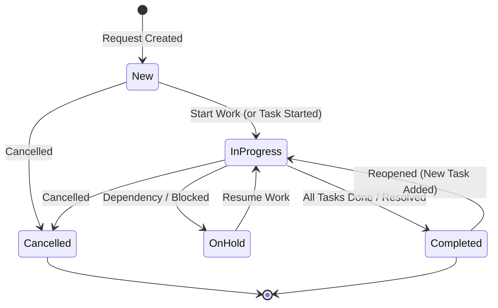
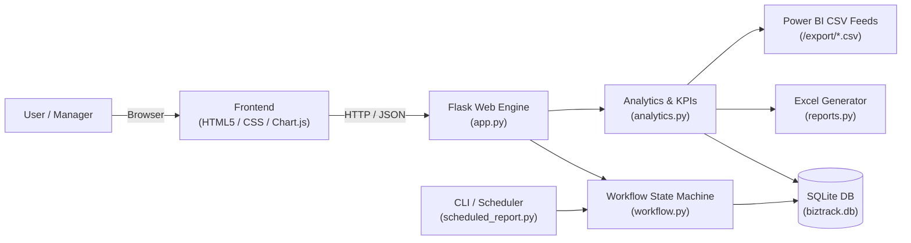

<div align="center">

# ⚡ BizTrack
### Business Analytics & Automated Workflow Management System

[](https://www.python.org/)
[](https://flask.palletsprojects.com/)
[](https://www.sqlite.org/)
[](https://pandas.pydata.org/)
[](https://www.chartjs.org/)
[](https://powerbi.microsoft.com/)
[](tests/)

<p align="center">
  <b>A full-stack operations management platform that automates service request lifecycles, synchronizes task progress, and delivers real-time business intelligence via interactive dashboards, automated multi-sheet Excel reports, and Power BI feeds.</b>
</p>

[Key Features](#-key-features) • [Interactive Kanban](#-interactive-kanban-board) • [Quick Start](#-quick-start) • [Architecture](#-architecture) • [REST Endpoints](#-rest-api-reference) • [Power BI](#-power-bi-integration)

</div>

---

## 🚀 Key Features

* **📋 Request & Task Management**: Centralized ticketing for cross-departmental operations (IT Support, Finance, HR, Procurement, Facilities, Operations) with subtask breakdowns.
* **📊 Interactive Kanban Board**: Real-time drag-and-drop workflow status updates across 5 lifecycle columns with state validation, subtask progress indicators, and toast alerts.
* **🔄 Automated Workflow Engine**: 
  * Automatically transitions requests from `New` $\rightarrow$ `In Progress` when the first subtask begins.
  * Automatically closes requests as `Completed` when all assigned subtasks are finished.
  * Reopens completed requests if new work or subtasks are added.
  * Auto-escalates overdue requests (1+ day overdue $\rightarrow$ **High**, 7+ days overdue $\rightarrow$ **Critical**).
* **📈 Data Processing & KPI Analytics**: Combines raw SQL aggregations and **pandas** to compute SLA compliance rate, average resolution days, workload heatmaps, and monthly intake trends.
* **📉 Live Analytics Dashboard**: Responsive UI with KPI summary cards and dynamic **Chart.js** visualizations fed by `/api/metrics`.
* **📑 Automated Excel Reporting**: Multi-sheet workbook generation (`openpyxl`) with custom executive styling, frozen headers, column autosizing, and native Excel pie/bar/line charts.
* **🟡 Power BI Data Feeds**: Exposes live REST CSV endpoints (`/export/requests.csv`, `/export/tasks.csv`) ready for scheduled cloud refresh or local desktop models.
* **🛡️ Immutable Audit Logging**: Every manual or automated status change is preserved in an audit table (`status_log`) with timestamps, actor notes, and state deltas.

---

## 📊 Interactive Kanban Board

BizTrack includes an interactive **Drag-and-Drop Kanban Board** accessible at `/kanban`:

```
+--------------------+--------------------+--------------------+--------------------+--------------------+
|     NEW (12)       |  IN PROGRESS (8)   |    ON HOLD (3)     |   COMPLETED (45)   |   CANCELLED (2)    |
+--------------------+--------------------+--------------------+--------------------+--------------------+
| [ #102 ] [Critical]| [ #98 ]  [High]    | [ #87 ]  [Low]     | [ #64 ]  [Medium]  | [ #42 ]  [Low]     |
| VPN Access Issue   | ERP Migration Task | Waiting on Vendor  | Q3 Budget Review   | Duplicate Request  |
| 👤 John (IT)       | 👤 Alice (Ops)     | 👤 Bob (Finance)   | 👤 Sarah (Finance) | 👤 Mike (HR)       |
| 📅 Due Tomorrow    | 📅 Due in 3 days   | 📅 Overdue         | 📅 Resolved        | 📅 Closed          |
| ✓ 0/2 tasks        | ✓ 2/3 tasks        | ✓ 1/2 tasks        | ✓ 4/4 tasks        |                    |
+--------------------+--------------------+--------------------+--------------------+--------------------+
```

* **Instant Visual Feedback**: Valid drop zones highlight in green/blue during drag, while disallowed state jumps are flagged immediately.
* **Optimistic UI with Rollback**: Card positions and column counters update instantly; invalid drops revert automatically with an informative error toast.
* **Dual-View Switcher**: Seamlessly toggle between **📋 Table View** and **📊 Kanban Board** on demand.

---

## 📐 Architecture & Workflow

### Request State Machine



### System Architecture



---

## ⚡ Quick Start

### 1. Prerequisites
* Python 3.10 or higher
* Git

### 2. Clone the Repository
```bash
git clone https://github.com/ROHITH-NATHANI/BizTrack.git
cd BizTrack
```

### 3. Setup Virtual Environment
**Windows (PowerShell):**
```powershell
python -m venv venv
.\venv\Scripts\Activate.ps1
```

**macOS / Linux:**
```bash
python3 -m venv venv
source venv/bin/activate
```

### 4. Install Dependencies
```bash
pip install -r requirements.txt
```

### 5. Seed Sample Data *(Optional)*
Generate 70 realistic demo requests, tasks, and historical logs across IT, Finance, HR, and Operations:
```bash
python seed.py
```

### 6. Run the Application
```bash
python app.py
```
Open your browser and visit: **[http://127.0.0.1:5000](http://127.0.0.1:5000)**

---

## 🧪 Running Automated Tests

Run the test suite using `pytest`:
```bash
pytest
```
Tests validate:
* Request creation and validation constraints
* State machine transition rules and guard checks
* Parent request auto-synchronization from task completions
* Overdue priority auto-escalation
* REST endpoints and Excel generation
* Kanban asynchronous status API (`POST /api/requests/<id>/status`)

---

## 🔌 REST API Reference

| Method | Endpoint | Description | Payload / Query |
| :--- | :--- | :--- | :--- |
| `GET` | `/` | Operational dashboard with live metrics | — |
| `GET` | `/requests` | Filterable table view of requests | `?status=&priority=&category=&q=` |
| `GET` | `/kanban` | Interactive drag-and-drop Kanban board | `?priority=&category=&q=` |
| `POST` | `/api/requests/<id>/status` | Asynchronous status update from Kanban | `{"status": "In Progress"}` |
| `GET` | `/api/metrics` | JSON metrics feed for charts and KPIs | — |
| `GET` | `/reports/excel` | Download generated multi-sheet Excel report | — |
| `GET` | `/export/requests.csv` | Power BI CSV feed for denormalized requests | — |
| `GET` | `/export/tasks.csv` | Power BI CSV feed for operational tasks | — |
| `POST` | `/automation/run` | Trigger manual overdue SLA escalation | — |

---

## 📑 Automated Excel Reporting (`reports.py`)

Run headless or download directly from the web interface:
```bash
python reports.py
```
Generates a structured workbook featuring:
1. **Summary Sheet**: KPI cards (Total, Open, Completed, Overdue, SLA %, Avg Days) and a native Excel donut/pie chart.
2. **Requests Sheet**: Full inventory with status badges, priority markers, and filterable headers.
3. **Category & Workload Sheet**: Breakdown of workload by team member with an embedded native Excel bar chart.

---

## 🟡 Power BI Integration

1. In **Power BI Desktop**, select **Get Data** $\rightarrow$ **Web**.
2. Enter the feeds:
   * Requests: `http://127.0.0.1:5000/export/requests.csv`
   * Tasks: `http://127.0.0.1:5000/export/tasks.csv`
3. Relationship: Connect `Tasks[request_id]` $\rightarrow$ `Requests[id]` (Many-to-One).
4. **Suggested DAX Measures**:
   ```dax
   Total Requests = COUNTROWS(Requests)
   Open Requests  = CALCULATE([Total Requests], Requests[status] IN {"New", "In Progress", "On Hold"})
   Overdue Count  = SUM(Requests[is_overdue])
   Avg Resolution = AVERAGE(Requests[resolution_days])
   SLA Compliance = DIVIDE(
       CALCULATE(COUNTROWS(Requests), Requests[met_sla] = 1),
       CALCULATE(COUNTROWS(Requests), NOT ISBLANK(Requests[met_sla]))
   )
   ```

---

## 📂 Project Structure

```
BizTrack/
├── app.py                 # Flask web application & REST API routes
├── workflow.py            # State machine, auto-sync rules & overdue escalation
├── analytics.py           # SQL queries & pandas data transformations
├── reports.py             # openpyxl multi-sheet Excel generator with native charts
├── db.py                  # Database connection & schema initialization
├── schema.sql             # SQLite table definitions, foreign keys & indexes
├── seed.py                # Populates 70 sample requests, tasks & audit logs
├── scheduled_report.py    # CLI / Cron scheduler for background escalations
├── requirements.txt       # Project dependencies
├── templates/             # Jinja2 HTML templates
│   ├── base.html          # Shell layout & global navigation
│   ├── dashboard.html     # KPI dashboard & Chart.js visualizations
│   ├── kanban.html        # Drag-and-drop interactive Kanban board
│   ├── requests.html      # Filterable tabular request list
│   ├── request_detail.html# Request detail, task management & audit log
│   └── request_new.html   # New request intake form
├── static/                # Static assets
│   ├── style.css          # Responsive styling (cards, badges, toasts, dark-mode)
│   ├── dashboard.js       # Chart.js rendering logic
│   └── kanban.js          # Drag-and-drop interaction & async API calls
├── tests/
│   └── test_biztrack.py   # Automated pytest test suite
└── powerbi/
    └── README.md          # Setup instructions & DAX formulas for Power BI
```

---

## 📄 License

Distributed under the MIT License. See [LICENSE](LICENSE) for more information.

<div align="center">
  <sub>Built with ❤️ by <a href="https://github.com/ROHITH-NATHANI">ROHITH-NATHANI</a></sub>
</div>
